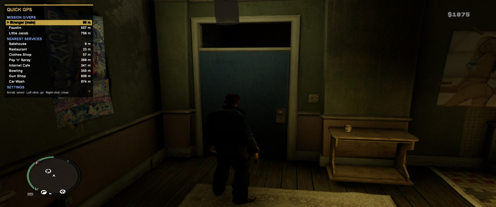
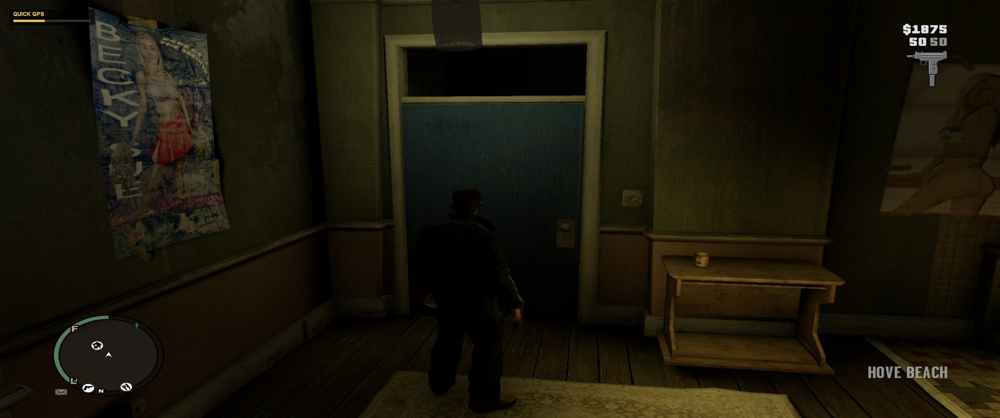
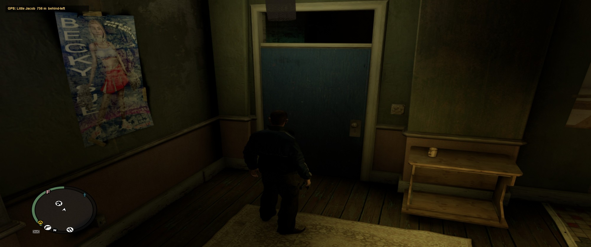

# QuickGPS for GTA IV

A quick GPS for GTA IV. Hold **Tab** for a second and a panel opens in the top-left corner listing:

- **Mission givers:** every contact on the map (Roman, Little Jacob, Brucie, strangers, assassination jobs and so on), nearest first.
- **Nearest services:** the closest one of each kind (Hospital, Gun Shop, Pay 'n' Spray, Clothes Shop, Burger Shot, Internet Cafe, Safehouse, Train Station, Taxi Rank, Bar, Bowling and more).

Scroll to one and left click. A yellow destination marker appears on the map with a GPS route to it, and a small line in the top-left shows the place, the distance and which way to go ("ahead-left"). The route clears itself when you arrive.

| Hold Tab: a bar fills, then the menu opens | After picking a destination |
|---|---|
|  |  |

## Controls

| Input | Action |
|---|---|
| Hold Tab (1 s) | Open the menu. A bar fills while you hold, so a quick tap does nothing. |
| Mouse wheel | Move the selection |
| Left click | Set a route to the selected entry |
| Right click, or Tab | Close the menu |
| F9 | Write a list of every map blip to `scripts\QuickGPS_blips.txt` (for bug reports) |

Niko keeps walking or driving while the menu is open. The game doesn't see your clicks or scroll wheel while it's open, so he won't shoot, aim or switch weapons.

**Changing the hotkey in game:** open the menu, scroll to **SETTINGS > Change hotkey** at the bottom, left click it and press the key you want. It's saved to `QuickGPS.ini` straight away. GTA IV's own pause-menu settings can't be extended by scripts, so this option lives in the QuickGPS menu. Everything else (hold time, mouse buttons, scroll direction, miles, and more) is in `QuickGPS.ini`, with a comment on each line.

## Requirements

- GTA IV: The Complete Edition **1.2.0.59**. Tested there; 1.0.7.0 / 1.0.8.0 should work with a matching ScriptHookDotNet but haven't been tested.
- An ASI loader (`dinput8.dll` from Ultimate ASI Loader; FusionFix setups already have one).
- **ScriptHookDotNet with Complete Edition support**: [Tomasak's fork](https://github.com/Tomasak/gta4_scripthookdotnet/releases) (tested with v1.7.1.8). [Priler's fork](https://www.nexusmods.com/gta4/mods/1217) should also work.
- .NET Framework 4.x (preinstalled on Windows 10 and 11).

## Install

1. Back up your saves (`Documents\Rockstar Games\GTA IV\`).
2. Install ScriptHookDotNet into the folder that holds `GTAIV.exe` (`...\Grand Theft Auto IV\GTAIV\`), following its own readme.
3. Extract the QuickGPS release zip into that same folder. It puts `QuickGPS.net.dll` and `QuickGPS.ini` in `GTAIV\scripts\`.
4. Start the game, load a save and hold Tab.

If nothing shows up, check `ScriptHookDotNet.log` in the GTAIV folder.

**Uninstall:** delete `scripts\QuickGPS.net.dll` and `scripts\QuickGPS.ini`.

## Notes and limits

- GTA IV only draws the GPS route line while you're in a vehicle. On foot, follow the yellow marker on the radar and the direction hint in the top-left.
- GTA IV has no script function for placing your own map waypoint, and it ignores route requests on the mission scripts' blips, so QuickGPS places its own destination marker instead.
- Only blips the game has placed are listed. Story contacts appear as they unlock, and some services only appear on the map after certain missions.
- Contacts from The Lost and Damned and The Ballad of Gay Tony use icons that aren't in the name table, so they show up as "Contact #id".
- QuickGPS ships precompiled. Don't also put `QuickGPS.cs` in the game's `scripts` folder: it would load twice, and ScriptHookDotNet's on-the-fly compiling of `.cs` scripts can crash the game on 1.2.0.59.
- Single-player only.

## Building from source

The source is `QuickGPS\src\QuickGPS.cs`. Run `QuickGPS\build.cmd` (optionally passing your GTAIV folder) to rebuild `QuickGPS\scripts\QuickGPS.net.dll`, and `QuickGPS\package.ps1` to build the release zip. It compiles against the game's own `ScriptHookDotNet.asi` with the C# compiler that ships with the .NET Framework, so no Visual Studio is needed.

## Credits

- ScriptHookDotNet by HazardX, with Complete Edition support by Tomasak; GTA IV Script Hook by Aru; `aCompleteEditionHook.asi` by LMS.
- QuickGPS was written with the help of Claude (Anthropic's AI assistant) and tested in game by Darj.

## License

QuickGPS is released under the [MIT License](LICENSE). ScriptHookDotNet and the other tools above have their own licenses.
